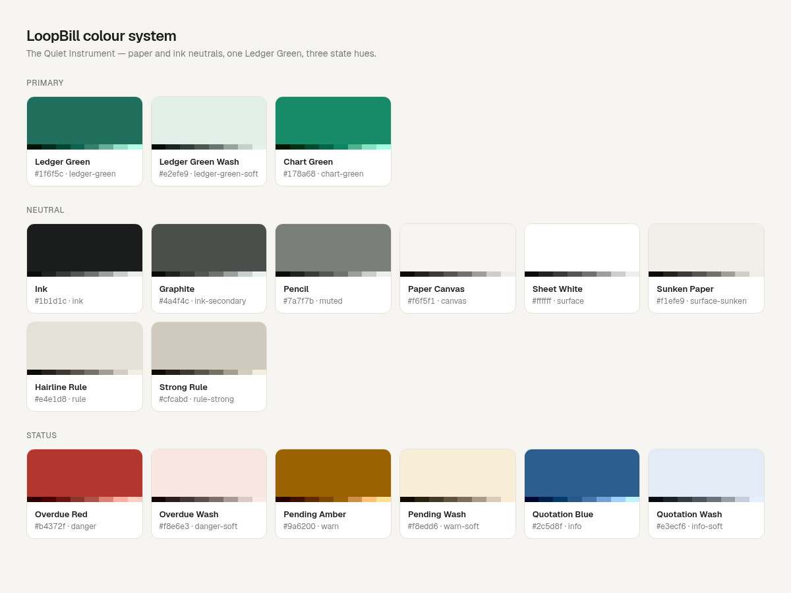
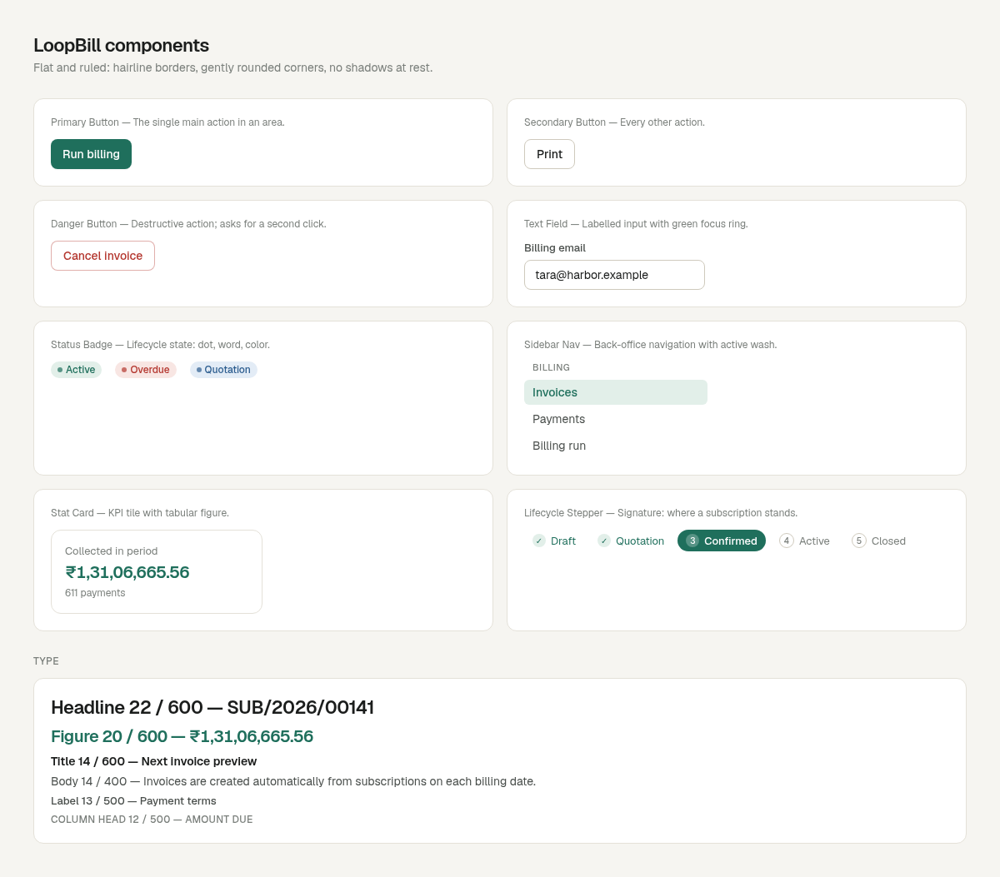

# Design System: LoopBill

## Overview

**Creative North Star: "The Quiet Instrument"**

LoopBill is a tool that recedes so the work can come forward. Most of the screen is warm paper and ink: off-white canvas, white working surfaces, near-black text and hairline rules. The interface is dense and legible because its users process hundreds of records at a time. Brand shows up in precise details rather than decoration: one green ink, perfectly aligned figures, and statuses that always tell you where a record stands.

Depth is tonal, not lifted. Sections sit on the canvas as flat, ruled cards. Tables are the main form. Numbers use tabular figures so columns of rupees line up to the paisa. Color is rationed: Ledger Green marks the primary action, the current place and money received. Red, amber and blue are reserved for state and never decorate.

Back office and customer portal share the same system. The portal uses a narrower column and top tabs instead of a sidebar, but the same cards, tables, badges and document styles.

**Key Characteristics:**
- Warm paper neutrals with a single green ink accent.
- Flat, hairline-ruled surfaces; no shadows at rest.
- Tables first, with tabular figures for every number.
- Status shown by pill badges that pair color with a dot and a word, never color alone.
- Dense but calm: 14px body, generous row height, quiet column headers.
- Full light and dark themes driven by the same tokens.

## Colors

Paper-and-ink neutrals carry almost everything; one green and three state hues do the signalling.

### Primary
- **Ledger Green** (#1f6f5c): primary buttons, the active nav item, links in tables, focus rings, "collected" figures and paid states. It is the only brand hue. In dark mode it lifts to #5fbf9f.
- **Ledger Green Wash** (#e2efe9): tinted backgrounds behind active nav items, Active/Paid badges and success notices.
- **Chart Green** (#178a68): data marks in charts only. It is more saturated than Ledger Green so bars don't read as gray. It was checked for chroma, lightness band and contrast, and steps to #2fa883 in dark mode.

### Neutral
- **Ink** (#1b1d1c): primary text and headings.
- **Graphite** (#4a4f4c): secondary text, table detail columns, labels.
- **Pencil** (#7a7f7b): hints, column headers, timestamps, empty-state copy.
- **Paper Canvas** (#f6f5f1): page background behind every card.
- **Sheet White** (#ffffff): cards, tables, inputs and the invoice document.
- **Sunken Paper** (#f1efe9): table header band, secondary hover, disabled fields, inline code.
- **Hairline Rule** (#e4e1d8): card borders, table row dividers, section separators.
- **Strong Rule** (#cfcabd): input and secondary-button borders.

### Status
- **Overdue Red** (#b4372f, wash #f8e6e3): overdue invoices, errors, destructive buttons.
- **Pending Amber** (#9a6200, wash #f8edd6): Confirmed and Paused states, warnings.
- **Quotation Blue** (#2c5d8f, wash #e3ecf6): Quotation state, informational notices, the Admin role badge.

### Named Rules
**The One Ink Rule.** Ledger Green is the only brand hue. Any new accent must be one of the status hues, used for state.

**The State-Only Rule.** Red, amber and blue appear only to mean a state (overdue, pending, quotation, error). They are never decoration.

**The Data Ink Rule.** Chart marks use Chart Green, never Ledger Green, and chart text stays in the ink tokens.

## Typography

**Display Font:** Geist (with ui-sans-serif, system-ui)
**Label/Mono Font:** Geist Mono is loaded but reserved; numbers use Geist with tabular figures.

**Character:** One neutral, precise grotesk for everything. Hierarchy comes from weight and size steps, not from mixing faces.

### Hierarchy
- **Headline** (600, 22px, tracking −0.025em): page titles and record numbers such as SUB/2026/00141.
- **Figure** (600, 17px on phones → 20px → 24px on very wide screens, tabular): stat-card values.
- **Title** (600, 14px): card headers and section titles.
- **Body** (400, 14px, 1.43): table cells, form values, descriptive copy.
- **Label** (500, 13px): form labels, small buttons, filter controls.
- **Column Head** (500, 12px, uppercase, tracking 0.025em, Pencil): table headers and nav section titles (11px).

### Named Rules
**The Tabular Rule.** Every number that can sit in a column (amounts, quantities, dates, document numbers) uses tabular figures.

**The One Face Rule.** Geist only. Add emphasis with weight; never add a display face.

## Layout

The back office is a two-column frame: a fixed 248px sidebar (white, hairline right rule, sticky) and a fluid content area capped at 1200px with 32px padding (16px on phones). Below 1024px the sidebar collapses into a top bar with a Menu drawer. The customer portal uses a 1024px centered column with top tabs.

Pages follow a fixed rhythm: page header (title, one-line subtitle, actions on the right), an optional row of stat cards (2 columns on phones, 4–5 on desktop), then cards. Detail pages split into a main column and a 340px side column for balance, discounts and activity. Gaps between cards are 24px; card padding is 20px; table cells are 16px × 12px.

**The Volume Rule.** Lists paginate at 25 rows, filter in the URL, and keep filters in one row directly above the table they control.

## Elevation & Depth

The system is flat. Depth comes from three tonal layers: Paper Canvas, then Sheet White cards, then Sunken Paper bands inside them. Hairline Rules separate everything. Shadows are rare and functional: a faint shadow on the primary button, and a medium shadow only on floating layers (chart tooltip, mobile nav drawer).

### Shadow Vocabulary
- **Button lift** (`box-shadow: 0 1px 2px rgb(0 0 0 / 0.05)`): primary button only.
- **Float** (`box-shadow: 0 4px 6px -1px rgb(0 0 0 / 0.1), 0 2px 4px -2px rgb(0 0 0 / 0.1)`): tooltips and the mobile drawer.

### Named Rules
**The Flat-By-Default Rule.** Surfaces are flat at rest. A shadow means the element floats above the page; anything sitting in the page uses a border instead.

## Shapes

Corners are gently rounded and consistent: 6px for nav items, 8px for buttons and inputs, 12px for cards and the invoice sheet, and fully round for status pills and avatar initials. Borders are 1px hairlines. Data-mark bars round only their top 4px corners and stay anchored to the baseline.

## Components

### Buttons
Quiet and decisive: one filled button per area, everything else outlined.
- **Shape:** gently rounded (8px), 36px tall (32px small), medium-weight label.
- **Primary:** Ledger Green fill, white label, button lift; hover brightens slightly.
- **Secondary:** Sheet White fill, Strong Rule border, Ink label; hover turns Sunken Paper.
- **Ghost:** no border, Graphite label; hover adds Sunken Paper and Ink.
- **Danger:** outlined in translucent Overdue Red with a red label; hover adds the red wash. Destructive actions ask for a second click ("Click again to confirm") instead of a dialog.
- **Pending:** while a server action runs, the label becomes "Working…" and the button disables.

### Status badges
- **Style:** fully round pill, 12px medium label, a 6px dot in the current color, and the state word in sentence case.
- **Mapping:** Active and Paid use green; Quotation uses blue; Confirmed and Paused use amber; Overdue uses red; Draft, Closed and Cancelled use neutral.

### Cards / Containers
- **Corner Style:** 12px.
- **Background:** Sheet White on Paper Canvas.
- **Shadow Strategy:** none (see Elevation).
- **Border:** Hairline Rule all round; the header is separated by a hairline.
- **Internal Padding:** 20px, or none when the card holds a full-bleed table.

### Stat cards
A small card with a 13px Pencil label, a Figure-size tabular value (green for money collected, red for overdue), and an optional 12px hint. Clickable stats link to the filtered list behind the number.

### Inputs / Fields
- **Style:** Sheet White, 1px Strong Rule border, 8px radius, 8px × 12px padding, 14px text.
- **Focus:** border turns Ledger Green with a 3px translucent green ring.
- **Error / Disabled:** red border with a 12px red message below; disabled fields turn Sunken Paper with Pencil text.

### Tables
Full-bleed inside cards. The header band is Sunken Paper with uppercase Column Heads; rows have hairline dividers and a faint Sunken Paper hover. Numeric columns are right-aligned and tabular. Record numbers are green links.

### Navigation
- **Sidebar:** 14px items in Graphite; hover adds Sunken Paper; the active item gets Ledger Green Wash and green medium text. Uppercase 11px section titles in Pencil.
- **Tabs:** the status filter above lists, with 2px green underline for the active tab and a count pill.
- **Mobile:** top bar with logo and a Menu toggle that opens a full-width drawer.

### Lifecycle stepper
The signature component. Draft → Quotation → Confirmed → Active → Closed, as numbered pills joined by short rules. Done steps show a green check, the current step is a filled green pill, and future steps are outlined in Pencil. Paused replaces Active's label in place.

### Invoice document
The printable invoice: logo and company block top-left, document number top-right, Bill-to and dates in two columns, a ruled line table, and a right-aligned totals block ending in a bold total. It is the same component on screen, in the portal and in print.

## Do's and Don'ts

### Do:
- **Do** keep Ledger Green (#1f6f5c) for the single primary action, the current location and money received.
- **Do** use tabular figures and right alignment for every amount, quantity and date column.
- **Do** pair every status color with a dot and a word in a pill badge.
- **Do** separate surfaces with 1px Hairline Rules (#e4e1d8) instead of shadows.
- **Do** keep text in ink tokens even next to a colored mark.
- **Do** keep both themes valid: every new color needs a light and a dark value in `globals.css`.

### Don't:
- **Don't** introduce a second brand hue or decorative gradients.
- **Don't** use red, amber or blue for anything except state.
- **Don't** add shadows to cards, tables or anything else that sits in the page.
- **Don't** add a second typeface.
- **Don't** show status with color alone.
