# LoopBill

**Plans, subscriptions and recurring billing in one place.**

LoopBill runs the full life of a subscription business: products and plans, quotations, subscriptions, automatic invoicing with taxes and discounts, payment collection, and revenue reporting. It has a staff back office and a self-service customer portal.

It is built for *Brightloop Software*, a company that sells software by the month or year. Before LoopBill, subscriptions lived in a spreadsheet, renewals were missed, and invoices were typed by hand. LoopBill replaces all of that.

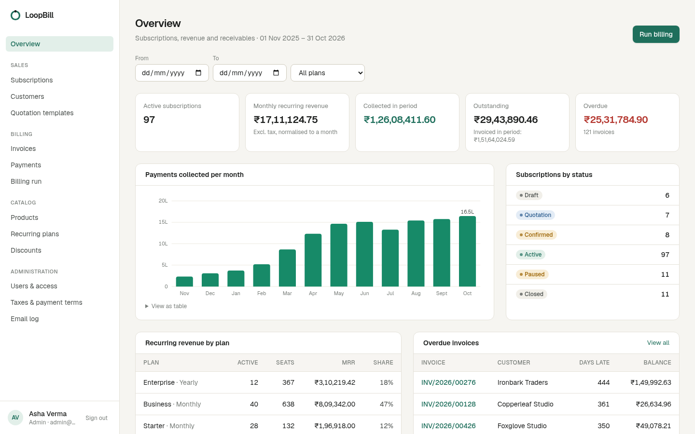

---

## What it does

| Area | Highlights |
| --- | --- |
| **Accounts & access** | Email + password sign-up (one account per email; passwords must be more than 8 characters with upper case, lower case and a special character), password reset by emailed single-use link, three roles: **Admin**, **Staff**, **Customer** (portal). Only admins can add staff, and they do it by invitation, so admins never handle passwords. |
| **Catalog** | Products with type, sales price, cost price, notes, tax rules and **variants** (e.g. *Brand: Northwind* adds ₹560). Recurring plans with price per unit, **daily / weekly / monthly / yearly** billing, minimum quantity, availability dates, and per-plan rules: close automatically at expiry, close early, pause, renew. |
| **Quotation → subscription** | Quotation templates with a plan, product lines, contract length and validity in days. Each subscription has a number, customer, plan, start/expiry dates, payment terms and lines (product, qty, unit price, taxes, amount). Lifecycle **Draft → Quotation → Confirmed → Active → Closed** (plus Paused), with a visual stepper and an activity log on every record. |
| **Billing** | A billing run turns every due period into an invoice: customer details, plan and add-on lines, discounts and taxes are all filled in automatically. Invoices go **Draft → Confirmed → Paid** (or Cancelled), can be confirmed in bulk, emailed and printed (or saved as PDF). The run is safe to repeat: periods are **never billed twice or skipped**. |
| **Discounts** | Admin-only rules: fixed amount or percentage, for specific products or a whole subscription, with minimum purchase / quantity, start & end dates and a usage limit. Attached discounts appear on the next invoice by themselves and stop when they expire or run out. |
| **Payments** | Record method, amount, date and note against an invoice; partial payments are supported, overpayments rejected. Paid vs outstanding vs overdue is visible everywhere. |
| **Reporting** | Overview with active subscriptions, monthly recurring revenue, money collected per month, outstanding and overdue receivables, revenue by plan and the oldest overdue invoices, all filterable by date range and plan. Lists have filters and summary totals. |
| **Customer portal** | Customers see only their own subscriptions and invoices. They can accept quotations, pause/resume/renew/cancel within the plan's rules, print invoices and update billing details. |

## Screenshots

| Subscription lifecycle | Quotation from a template |
| --- | --- |
| 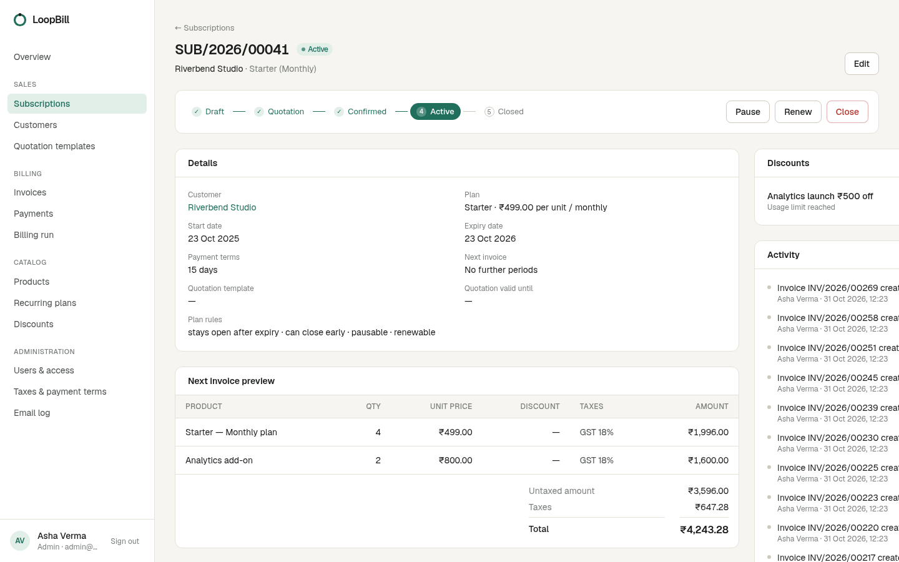 | 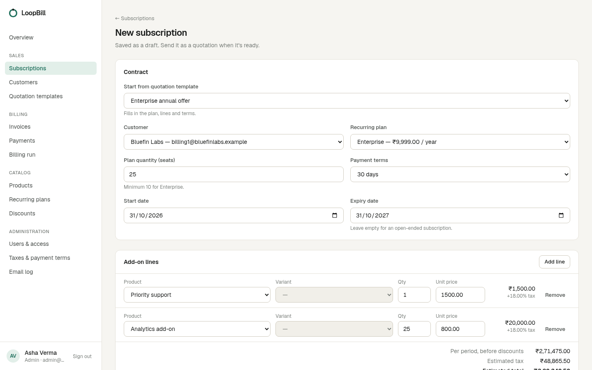 |
| **Billing day: drafts confirmed in bulk** | **Invoice with discounts, taxes and payments** |
| 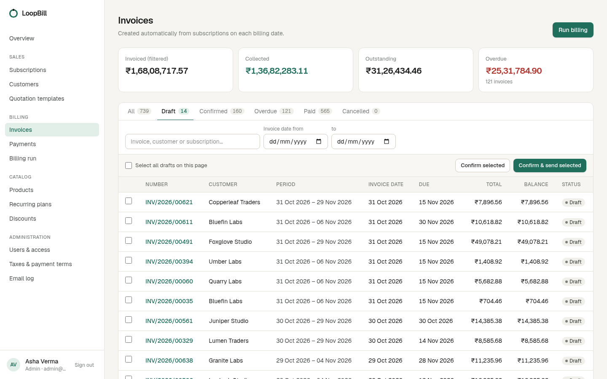 | 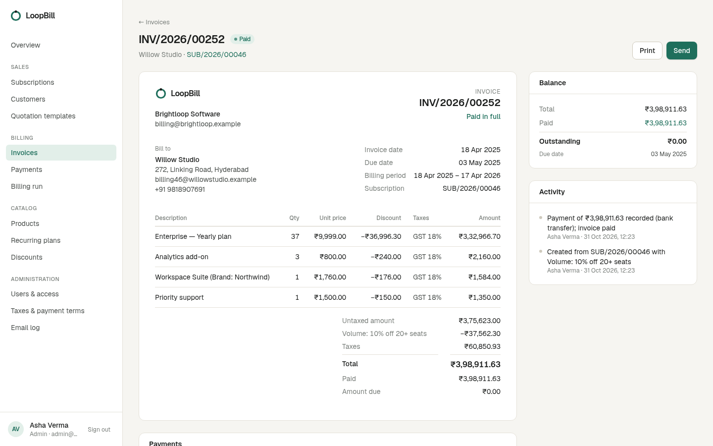 |
| **Customer portal** | **Customer accepts a quotation** |
| 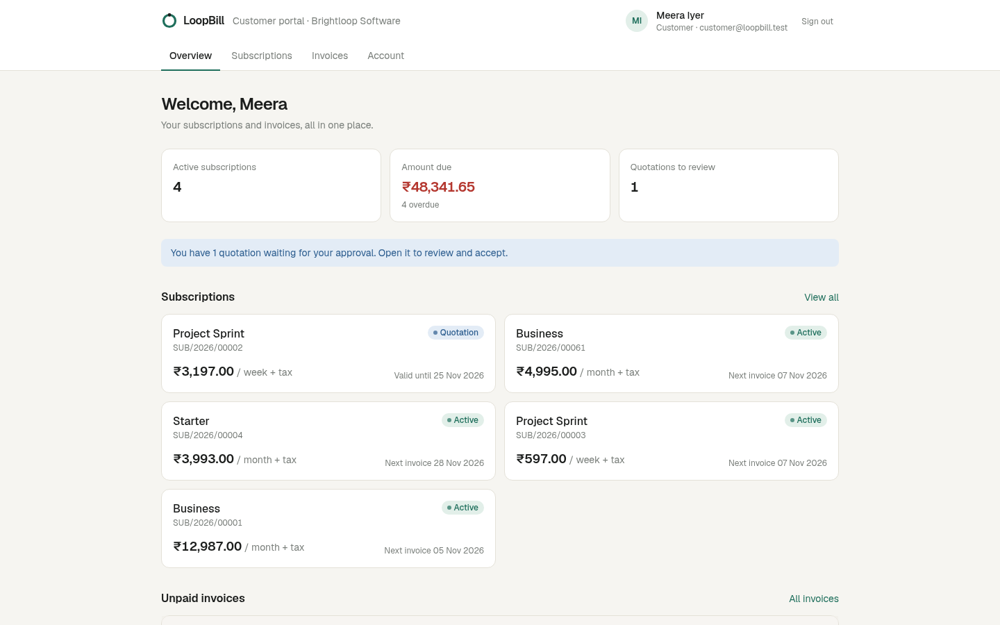 | 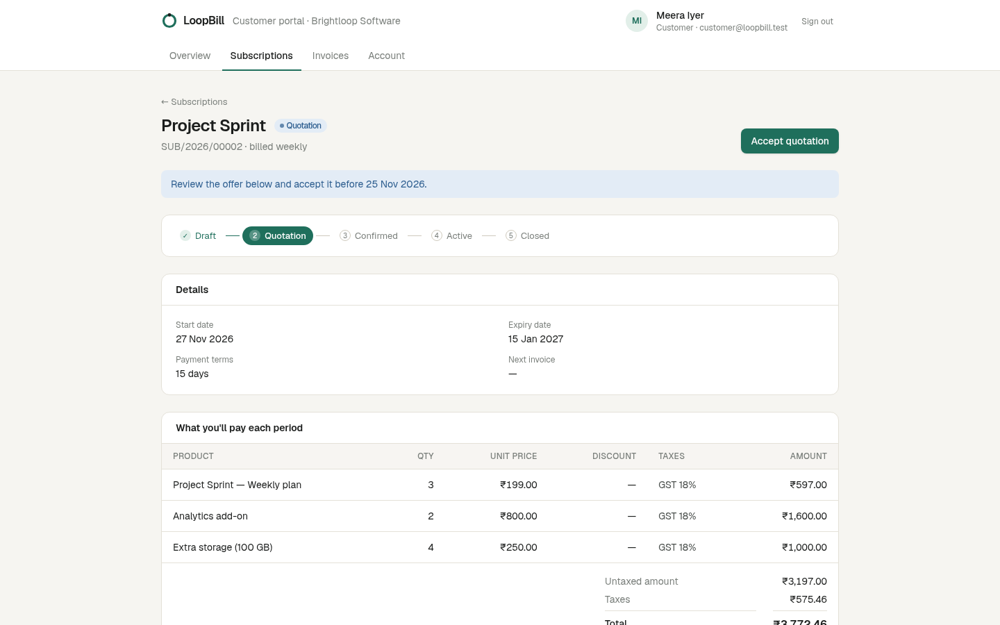 |
| **Products with variants and tax rules** | **Dark mode** |
| 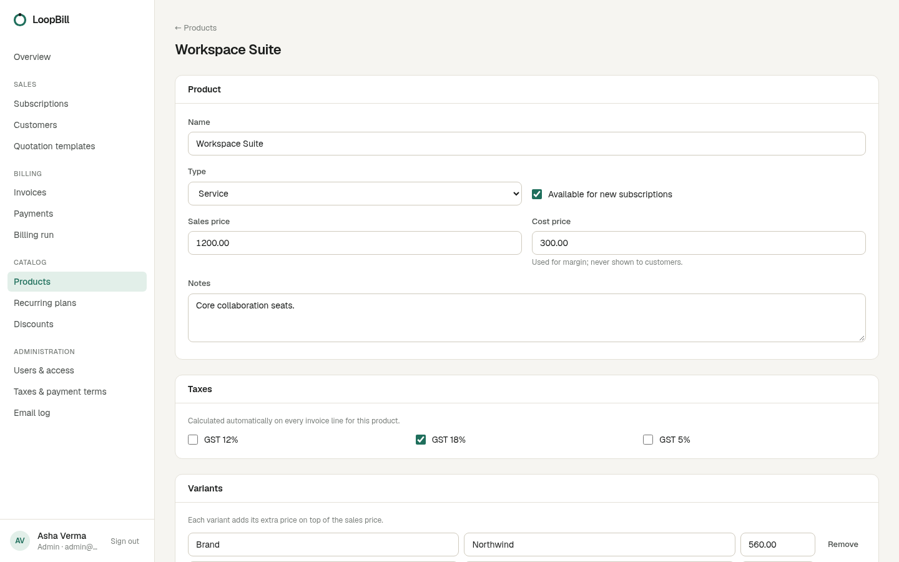 | 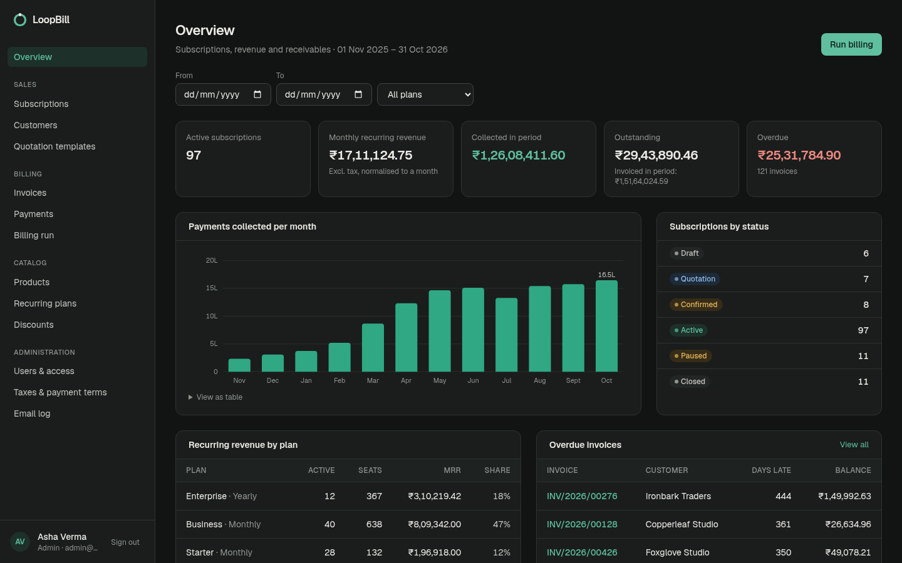 |

<p>
  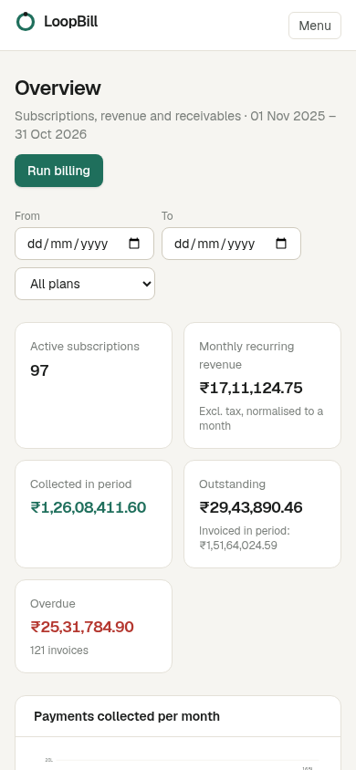
  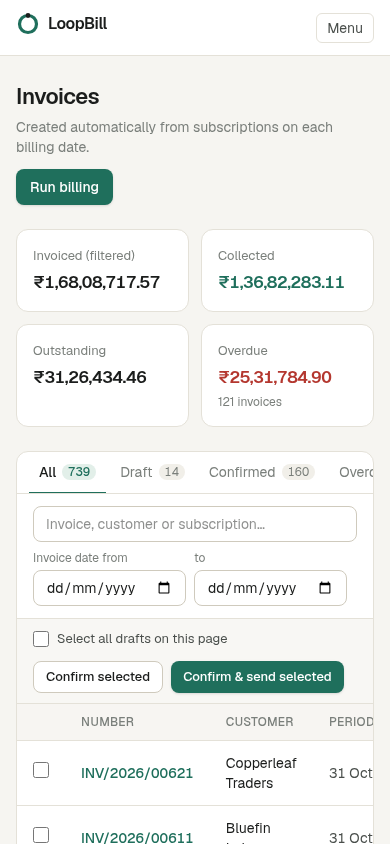
  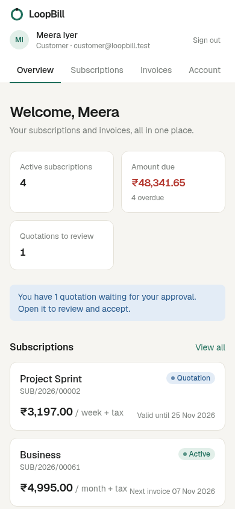
</p>

Every screen is in [`docs/screenshots/`](docs/screenshots/); the design system is documented in [`DESIGN.md`](DESIGN.md), and a demo walkthrough is in [`docs/demo-video-script.md`](docs/demo-video-script.md).

## How billing stays correct

Billing is the part that must never be wrong, so it is designed to be correct even under concurrency:

- **Anchored periods.** Period *n* always starts at `startDate + n × period`, computed from the start date. Month-end dates never drift (Jan 31 → Feb 28 → Mar 31).
- **One cursor per subscription.** `invoicedCycles` advances in the same transaction that creates the invoice, while the subscription row is locked (`SELECT … FOR UPDATE`). Two overlapping runs serialise instead of double-billing.
- **Database guard.** A partial unique index allows only one live (non-cancelled) invoice per subscription per period start.
- **Catch-up, not skip.** If a run was missed, the next run bills every missed period in order.
- **Exact usage limits.** Discount rows are locked in a stable order while an invoice is priced, so a usage limit of 1 means exactly one invoice, however many subscriptions bill at once. Cancelling an invoice gives the use back.
- **Integer money.** All arithmetic is done in paise. Discounts are spread across lines with a largest-remainder split, so totals always add up to the cent. Tax is charged on the discounted amount.
- **Guarded transitions.** Every status change is a conditional update on the status it was validated against, so two people clicking at once can't both apply it.

These guarantees are covered by integration tests (`src/server/billing.test.ts`).

## Tech stack

- **Next.js 16** (App Router, Server Components, Server Actions), React 19, TypeScript
- **PostgreSQL 17** with **Prisma 7** (driver adapter `@prisma/adapter-pg`)
- **Tailwind CSS 4**
- Custom session auth (bcrypt + hashed session tokens in httpOnly cookies)
- Nodemailer (SMTP) for quotations, invoices, invitations and password resets
- Vitest for unit and integration tests

## Getting started

Requirements: Node.js 20.9+, Docker (for PostgreSQL).

```bash
npm install                 # also generates the Prisma client
cp .env.example .env        # adjust if needed
npm run db:up               # start PostgreSQL on localhost:5433
npm run db:migrate          # apply migrations
npm run db:seed             # demo data (≈140 subscriptions, full billing history)
npm run dev                 # http://localhost:3001
```

### Demo accounts

| Role | Email | Password |
| --- | --- | --- |
| Admin | `admin@loopbill.test` | `Admin@12345` |
| Staff | `staff@loopbill.test` | `Staff@12345` |
| Customer | `customer@loopbill.test` | `Customer@123` |

### Email

Set `SMTP_HOST`, `SMTP_PORT`, `SMTP_USER`, `SMTP_PASSWORD` and `MAIL_FROM` in `.env` to send real email. Without SMTP, messages are printed to the server console. Either way, admins can see every message under **Administration → Email log**. Reset links are redacted there once a message has been delivered.

### Scheduled billing

Run billing from the **Billing run** page, or schedule it daily:

```bash
curl -X POST -H "Authorization: Bearer $CRON_SECRET" http://localhost:3001/api/cron/billing
# or
npm run billing:run
```

## Scripts

| Command | What it does |
| --- | --- |
| `npm run dev` | Development server on port 3001 |
| `npm run build` / `npm start` | Production build / server |
| `npm test` | Unit + integration tests (needs the database running) |
| `npm run typecheck` | Route type generation + TypeScript |
| `npm run lint` | ESLint |
| `npm run db:seed` | Reset and load demo data |
| `npm run db:seed -- --bulk` | Reset and load ~4,000 subscriptions / ~20,000 invoices for load testing |
| `npm run db:reset` | Drop, re-migrate and seed |
| `npm run billing:run` | Run the daily billing job once |

## Performance

All list pages are paginated server-side, filtered in SQL and backed by indexes on the columns they filter and sort by. Report figures come from single aggregate queries. With the bulk data set (4,000 subscriptions, 19,500 invoices, 16,000 payments), every page tested responded in **under 0.2 s** on the production server and under 0.5 s in development, well inside the 2-second target.

## Roles

| | Admin | Staff | Customer |
| --- | :-: | :-: | :-: |
| Products, plans, taxes, discounts, templates | edit | view | — |
| Customers, subscriptions, quotations | ✓ | ✓ | own only |
| Invoices, payments, billing runs | ✓ | ✓ | view own |
| Users & access, email log | ✓ | — | — |

## Project structure

```
prisma/
  schema.prisma          data model
  migrations/            includes the billing guard index and checks
  seed.ts                demo data, billed through the real engine
src/
  app/(auth)/            sign up, sign in, password reset
  app/(app)/             staff back office (one folder per area)
  app/portal/            customer portal
  app/print/             printable invoice
  app/api/cron/billing/  scheduled billing endpoint
  components/            UI kit, forms, invoice document, chart
  lib/                   money, dates, pricing, auth, mail, validation
  server/                billing engine, subscription lifecycle, invoices
  proxy.ts               request gate (session cookie check)
```
